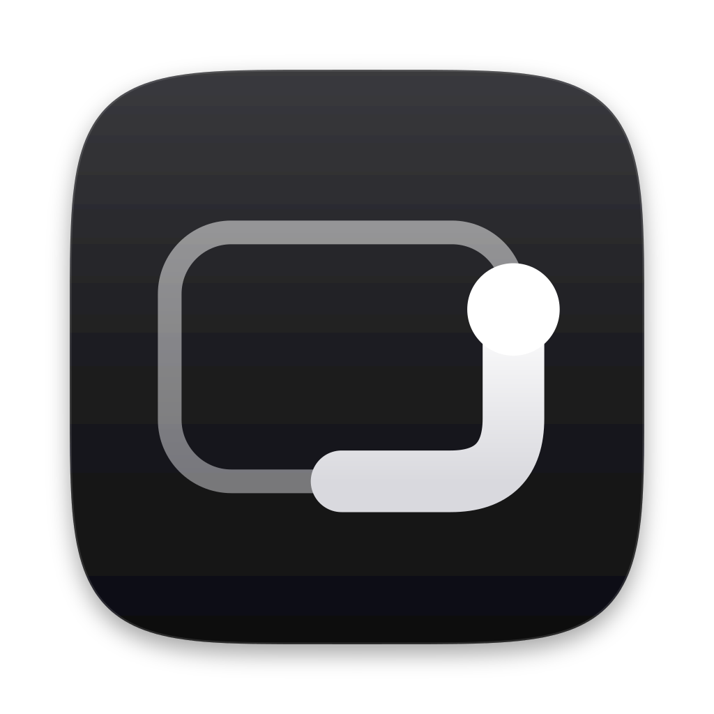

<p align="center"></p>

# Rim

[](https://github.com/broisnees/rim/actions/workflows/ci.yml)

A macOS menu bar app that turns the edges and corners of your trackpad into controls, with haptics
that feel like part of the Mac. Requires macOS 14+ and a Force Touch trackpad.

Every zone is a set of "when you … → do …" bindings (Settings → Zones):

| Zone | Gestures | Default |
|---|---|---|
| 4 corners | tap · double-tap · press & hold | TL Mission Control · TR Show Desktop · BL Screenshot · BR Spotlight (×2 Toggle Sidebar) |
| Left / right edge | slide (volume, brightness, or actions) · tap | brightness / volume |
| Top edge | same | not set |
| Bottom edge | same | swipe → / ← next / previous track, tap play / pause |

Edge **actions** mode runs one action when sliding up/right and another down/left, either once per swipe or repeatedly every N mm. Presets: tabs, desktops, zoom, undo/redo, tracks, back/forward, page up/down, window halves. Corners and edges can be overridden per app.

Haptic tick on every 1/16 step, a bump at 0 % and 100 %, a click when an action fires.
Normal use is untouched: two fingers, starting outside a zone, or physically pressing the trackpad all behave as usual.

## Gestures, haptics, automation

- **Multi-finger taps** – 3 / 4 / 5-finger tap, tip-tap left/right (rest one finger, tap another), two-hand tap (fingers ≥ 55 mm apart). Taps only, so three-finger drag and system swipes keep working; conflicts with macOS settings are flagged in Settings → Gestures.
- **Haptic patterns** – tick, light/medium/strong, double, triple, ramp, success, warning, error, heartbeat; choose one per event and the actuator pulse for each strength (Settings → Haptics).
- **Automation** – `open -g rim://haptic/success`, `open -g rim://run/windowLeft`, `open rim://settings/gestures`, or `Rim --haptic error` without the app. URL `run/` only accepts input-free actions, so web pages can't run commands.
- **Actions** – window left/right/top/bottom/fill/center/next display/minimize/full screen, middle click, previous app, plus everything before.

## Tests

`scripts/test.sh` – hardware probe, motion math, gesture recognizer (incl. look-alikes that must not fire), input-safety gate, performance.

## Build

```sh
./make-cert.sh            # once: local signing identity so Accessibility survives rebuilds
./build.sh --install --run
```

Grant **Accessibility** when asked (System Settings → Privacy & Security → Accessibility).
Self-test without the app: `.build/release/Rim --probe`.

## Config

`~/Library/Application Support/Rim/config.json` (Settings → General → Reveal Config File). It reloads automatically when saved.

Action types: `none playPause nextTrack previousTrack mute missionControl appWindows showDesktop lockScreen sleepDisplay screenshot spotlight`, plus ones that take a `value`:

```json
"topLeft":     { "type": "app",      "value": "Safari" },
"topRight":    { "type": "shortcut", "value": "My Shortcut" },
"bottomLeft":  { "type": "keys",     "value": "cmd+shift+4" },
"bottomRight": { "type": "shell",    "value": "open ~/Downloads" },
"url":         { "type": "url",      "value": "https://example.com" }
```

Tuning: `edges.width`, `edges.speed`, `edges.acceleration` (0 = linear, 1 = full), `corners.width/height`, `media.height`, `media.swipeDistance` (all fractions of the trackpad), `hapticIDs` (1–6, 15, 16), `invertY`.
Use **Touch Visualizer…** to see the zones and your fingers live. **Debug Log** writes to `~/Library/Logs/Rim.log`.


### Actions (any zone or gesture)

Editing (copy, paste, cut, paste & match style, undo, redo, select all, find, save) · scrolling & zoom (page up/down, top, bottom, zoom in/out, actual size) · controls (volume, brightness and keyboard-light up/down, keyboard light on/off) · media · windows (halves, fill, center, next display, minimize, full screen, new/close window) · app-aware tabs, sidebar, back/forward · middle click, previous app, emoji picker, force quit · Mission Control, desktop, Spotlight, screenshot, lock, sleep display · open app, run Shortcut, press keys, open URL, run command.

### Edge feel (inspired by how Mac Mouse Fix animates scrolling)

- Edge sliders: volume, brightness or **keyboard light**, with speed-dependent acceleration.
- Edge actions: speed-boosted swipes (eased 1×–2.5×), fire-on-lift for short swipes, **momentum** after a flick (physical drag, stops on the next touch), and **speed-up** for quick repeated slides.

## Motion

- **Filtering** – 1€ filter on finger position: 0.3 mm sensor jitter → 0.02 mm at rest, ~7 ms lag at 200 mm/s.
- **Acceleration** – speed-dependent gain, smooth in log-speed like macOS pointer acceleration: 0→100 % takes 110 mm slow, 46 mm at 60 mm/s, 24 mm when flicking. Physical millimetres (read from the trackpad), so it feels the same on any size.
- **Detents** – 16 steps like system volume; one haptic per step, hysteresis so a resting finger never double-ticks, rate-limited so flicks don't buzz; a distinct bump at 0 % / 100 %.
- **Rubber band** – pushing past an end stretches the bar with Apple's `(1 − 1/(x·0.55/d + 1))·d` curve and springs back (8 % overshoot) on release.
- **HUD** – springs (SwiftUI-style response/damping) stepped on the display link: critically damped level, scale+fade presence.
- **Flick** – a short fast swipe (≥ 40 % distance at ≥ 220 mm/s) skips tracks, like iOS.

## Accidental-touch rejection (`guardrails`)

- `typingPause` – no zone gesture starts within 0.5 s of a real keystroke.
- `palmSize` – oversized contacts (palm, thumb side) are ignored; the visualizer shows each contact's size.
- `multiFingerCooldown` – fingers lifting unevenly after a scroll can't trigger zones.
- `activationWindow` – a slider must engage within 0.6 s and move mostly *along* the edge; a resting or drifting palm never engages.
- `minTap` / `maxTap` – taps must be deliberate: not a graze, not a rest, and still (< 2 mm).

## How it works

- `Sources/CMT` – C shim that `dlopen`s private `MultitouchSupport` (raw finger frames, Force Touch actuator) and `DisplayServices` (brightness).
- `GestureEngine` – per-trackpad state machine: zone → slider / tap / swipe, cancels on 2nd finger or leaving the zone.
- `EventGate` – HID event tap that swallows cursor motion and tap-to-click while a zone owns the finger; a physical press cancels the gesture.
- `SystemControls` – CoreAudio volume, brightness, media keys, key combos, haptics. `HUD` – on-screen level.

Uses private APIs, so it can't ship on the Mac App Store.
